# Architecture

> **Final round:** the current, detailed diagram set (16 diagrams, each with a full explanation) is in [`docs/architecture/`](architecture/README.md), with PNG/SVG exports in [`docs/diagrams/`](diagrams/). The diagrams below document the Round 1 system and are kept for history; their images moved to `docs/diagrams/round1/`.

## Diagrams

Eighteen diagrams, drawn from the code as it runs. GitHub renders them; the same set is published as an interactive page. Together they cover every component, every graph path, every policy rule and every one of the twenty benchmark cases.

1. [System architecture](#01-system-architecture)
2. [Investigation loop](#02-investigation-loop)
3. [Graph access through MCP](#03-graph-access-through-mcp)
4. [Graph schema](#04-graph-schema)
5. [GraphRAG memory](#05-graphrag-memory)
6. [Decision authority](#06-decision-authority)
7. [Ring detection](#07-ring-detection)
8. [Case lifecycle](#08-case-lifecycle)
9. [Before / after evidence](#09-before--after-evidence)
10. [Data and install pipeline](#10-data-and-install-pipeline)
11. [The temporal wall](#11-the-temporal-wall)
12. [Trust boundaries](#12-trust-boundaries)
13. [Policy rules as code](#13-policy-rules-as-code)
14. [All twenty benchmark cases](#14-all-twenty-benchmark-cases)
15. [Analyst console and API](#15-analyst-console-and-api)
16. [Autonomous monitoring](#16-autonomous-monitoring)
17. [Evaluation and verification](#17-evaluation-and-verification)
18. [Failure modes and fallbacks](#18-failure-modes-and-fallbacks)

### 01 System architecture

Three triggers enter one LangGraph agent. The agent reaches TigerGraph only through a gateway that prefers the TigerGraph MCP server. Decisions come from a deterministic core, and the LLM only writes prose.

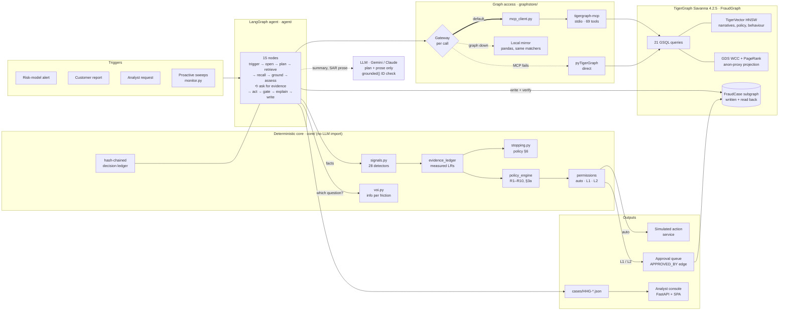

- **The graph decides.** Probabilities, actions and routes are computed in `core/`; a test fails the build if it ever imports an LLM client.
- **MCP is the default path.** 1,492 calls on the last run, 0 fallbacks. Direct and local paths exist so a sleeping workspace can't kill a demo.
- **Writes are checked.** A case counts as written only after `case_chain` reads it back.

### 02 Investigation loop

One conditional edge makes this an agent: after every assessment it either gathers more evidence or acts, and the provisional recommendation is recorded before any question is asked.

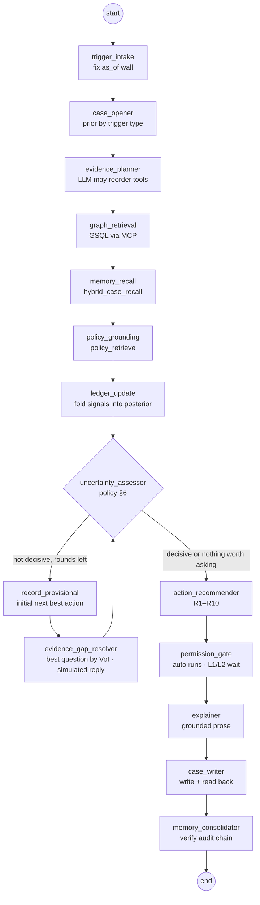

- **Stop rule**: p ≥ 0.85 or ≤ 0.15 on two independent pieces of evidence, a reply that settles it, or nothing left worth its friction.
- **Round cap** is enforced in code (`MAX_EVIDENCE_ROUNDS`), not by the model.

### 03 Graph access through MCP

Each graph call tries the official TigerGraph MCP server first and falls back per call, so one failed tool call degrades a single read instead of the case.

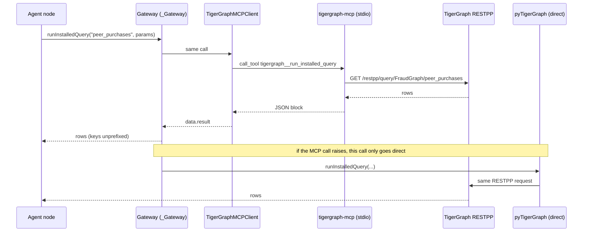

- **Tools used**: `run_installed_query`, `get_node`, `get_node_edges`, `add_node`, `add_edge`.
- **GRAPH_STRICT=1** fails closed: an unreachable graph raises instead of silently serving the mirror.

### 04 Graph schema

One graph holds three layers: the evidence the bank already has, the memory of 5,565 closed investigations, and every case the agent writes back.

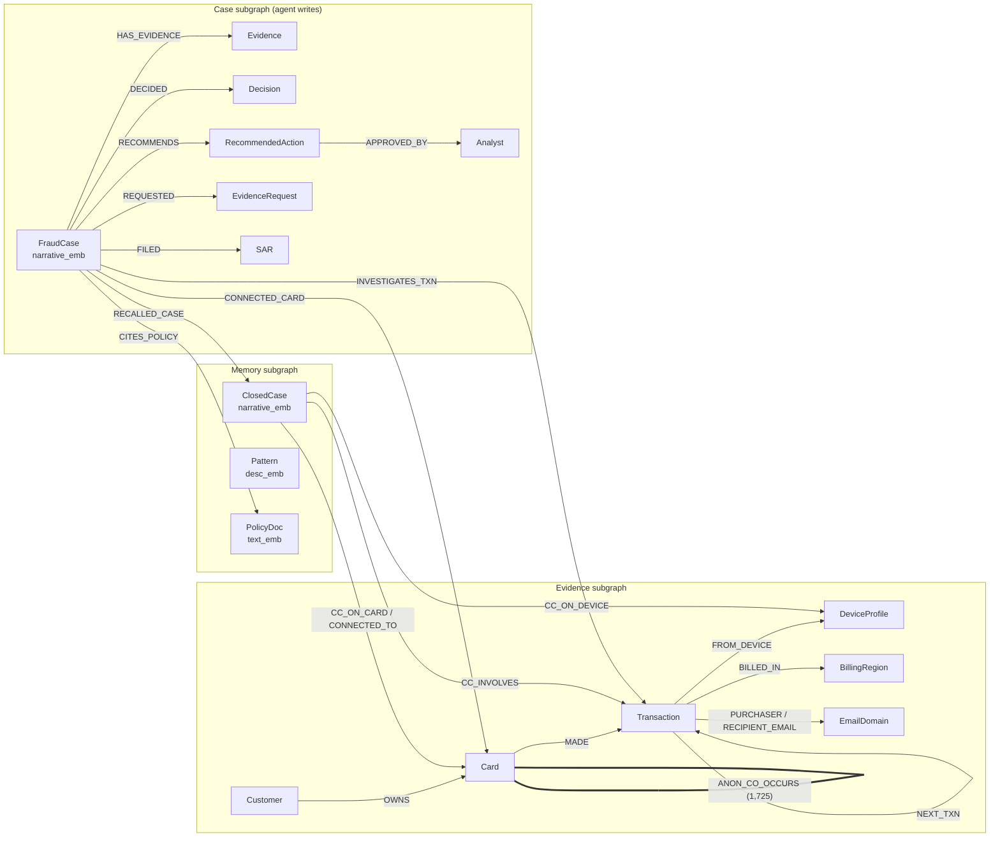

- **Reserved words** on 4.2 forced `FraudCase` (not Case), `proxy_type`, `friction_cost`.
- **Card attributes** `community_id` and `hub_rank` are written by WCC and PageRank.

### 05 GraphRAG memory

Similar past cases are found two ways inside one query, by meaning and by shared entities, and fused. Policy clauses are retrieved the same way and handed to the model as citable text.

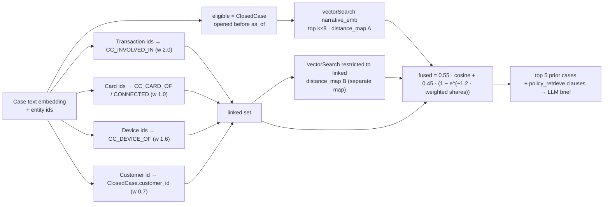

- **Why two maps.** MapAccum sums repeated keys; one shared map doubled the distance of cases found by both searches.
- **Filter before top-k**, so future cases can never crowd out eligible ones.

### 06 Decision authority

Evidence becomes numbers through likelihood ratios measured on the bank's own closed cases; numbers become actions only through the written policy.

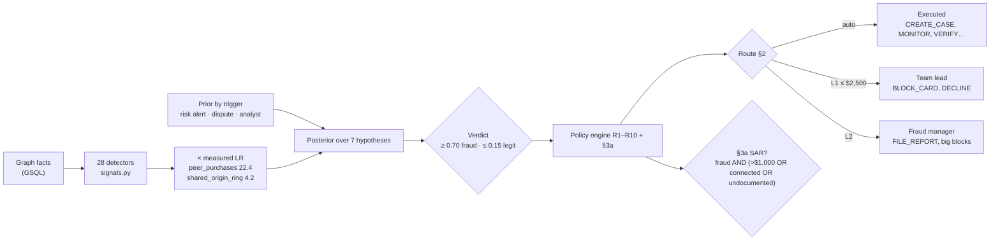

- **Probability capped** at 0.97 / 0.02: no investigation on this evidence is certain.
- **Claim types** on every evidence item: graph fact, derived inference, model score, policy text, simulated reply.

### 07 Ring detection

Raw device sharing is noise: 92% of online purchases sit on a profile shared by 3+ cards. Three gated signals separate real rings from popular browsers.

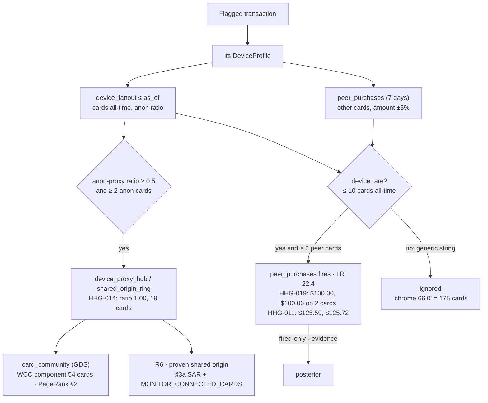

- **WCC on the full projection** gives one 6,125-card blob; on the anonymous-proxy slice it isolates the ring.
- **Algorithm output is context**, never probability: it is all-time structure behind the temporal wall.
- **Peers are evidence, not connected cards.** On the October holdout, counting them as connected filed 19 reports the bank never filed; counting their absence cost 19 pattern calls.

### 08 Case lifecycle

A case is opened as a graph object, may pause for evidence, closes with a verdict, and its consequential actions stay pending until a person approves them.

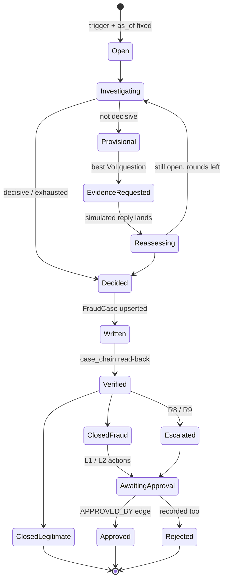

### 09 Before / after evidence

The recommendation is recorded before the question and again after the answer. HHG-018 is a disputed charge the card has paid 21 times before.

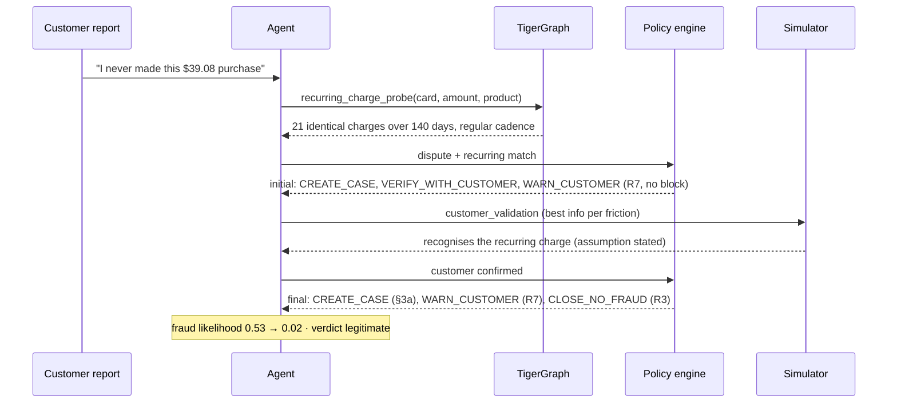

### 10 Data and install pipeline

Raw CSVs are staged once, calibrated against the closed cases, and loaded into Savanna by an idempotent, resumable installer.

```mermaid
flowchart LR
  RAW["Datasets/<br/>transactions · identity<br/>closed cases · case pack"] --> N1["01 normalise<br/>card_id recovery 100%"]
  N1 --> N2["02 behaviour vectors<br/>64-d"]
  N2 --> N3["03 policy → 41 chunks"]
  N3 --> N4["04 memory<br/>384-d narratives"]
  N4 --> N5["05 calibrate<br/>matched controls, LRs"]
  N5 --> N7["07 verify"]
  N4 --> N6["06 stage graph CSVs"]
  N6 --> I1["install: schema"] --> I2["vectors"] --> I3["load<br/>48 MB chunks"] --> I4["21 queries"] --> I5["projections"] --> I6["GDS WCC + PageRank"] --> I7["verify"]
  N7 --> RUN["run_20.py → cases/"]
  I7 --> RUN
  RUN --> AU["audit_answers.py<br/>0 issues"]
  
```

### 11 The temporal wall

Every read stops at the moment the alert opened; nothing the agent cites can postdate it, and the baseline stops 72 hours earlier still.

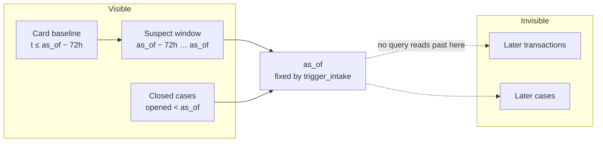

- **Audited**: no affected transaction or prior case in any answer file postdates its alert.

### 12 Trust boundaries

The language model sits outside the decision boundary; people sit on the approval boundary.

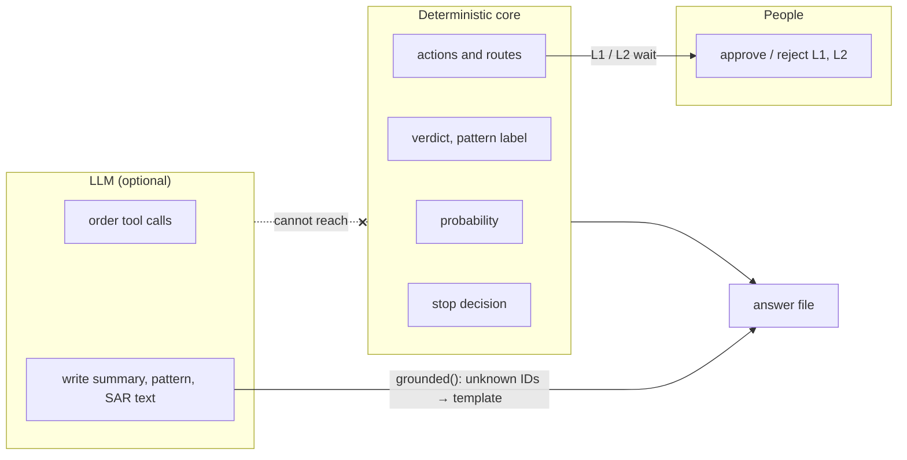

- **Enforced** by `test_core_cannot_import_an_llm` and by the policy engine dropping any action it did not produce.
- **Runs without an LLM**: same verdicts, template prose.

### 13 Policy rules as code

Every recommended action traces to one clause of the written Fraud Policy. The engine tests each rule against the case; the route for each action comes from §2, and the SAR decision from §3a, separately from the verdict.

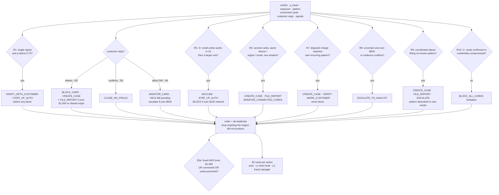

- **§3a is its own test.** HHG-019 is fraud at 0.95, but $99.92 on one card with a documented pattern meets none of the conditions, so no SAR.
- **Guard.** An action that breaches a rule (a block on one weak signal, a block under R7) is refused, not just discouraged.

### 14 All twenty benchmark cases

Every case in the benchmark, grouped by the path it took from trigger to final action: 11 legitimate, 9 fraud, 2 SARs, and 5 cases that asked a question and changed their decision.

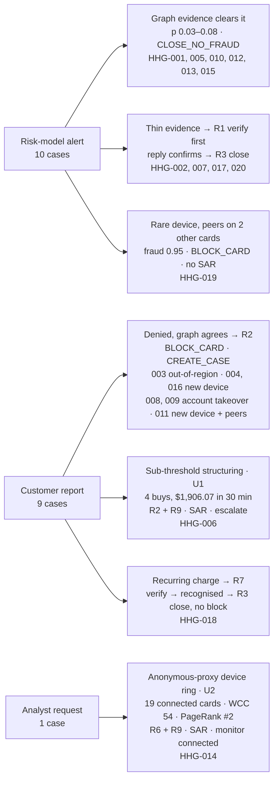

- **Changed after evidence**: HHG-002, 007, 017, 018, 020.
- **SAR filed**: HHG-006, HHG-014.
- **Undocumented patterns**: HHG-006 (structuring), HHG-014 (proxy ring).

### 15 Analyst console and API

The console is a static page over one FastAPI process. Every number on screen is read from the answer files, the graph or the calibration tables; the only writes are approvals and the live re-run's case write.

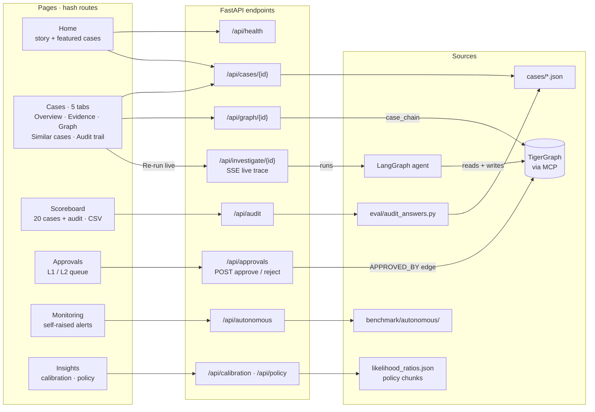

- **Deep links**: `#/cases/HHG-019/evidence` opens a case on a tab.
- **Evidence tab** draws the probability path: trigger prior → each ledger entry → calibration and caps → final.
- **No build step**: vanilla JS, one `python ui/server.py`.

### 16 Autonomous monitoring

Outside the benchmark, the agent raises its own alerts over November–December from three sources and investigates each exactly as it would a bank alert. The sweeps find what a per-transaction score cannot, because the pattern only exists across several transactions or cards.

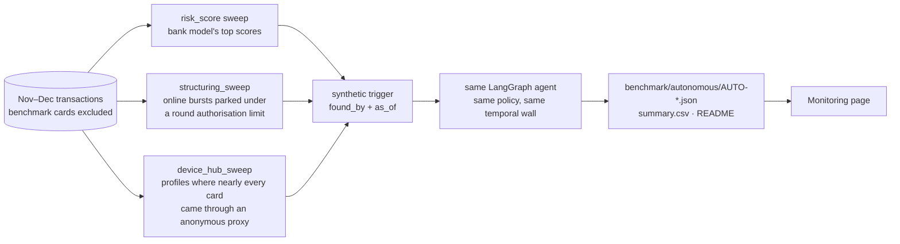

- **Never mixed** into `cases/`: the submission stays exactly the twenty benchmark answers.

### 17 Evaluation and verification

Weights are measured on July–September closed cases and tested on an October holdout the calibration never saw. The twenty answers are audited against the raw data, and two backends must agree on every case.

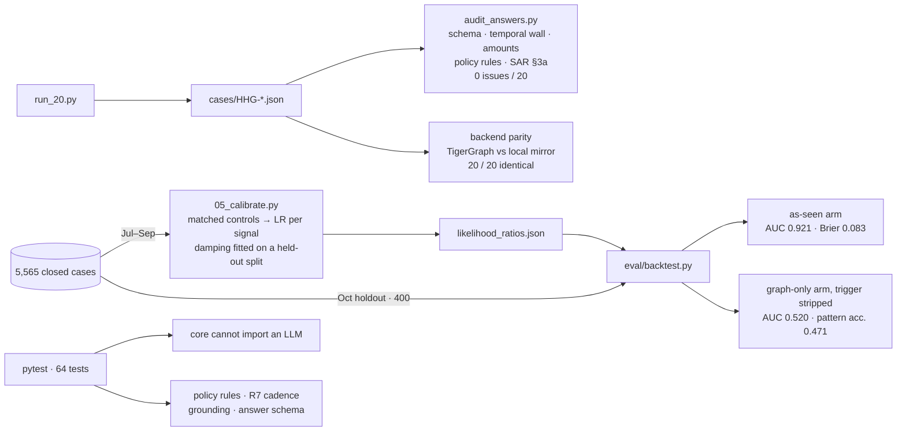

- **Why two arms.** In this history the trigger is perfectly correlated with the label, so a single precision figure would measure the label, not the agent.
- **Ablation switch.** `SIGNALS_OFF=peer_purchases` forces a detector off so its worth can be measured.

### 18 Failure modes and fallbacks

Each dependency has one defined fallback, and each fallback shows up in the output rather than happening silently.

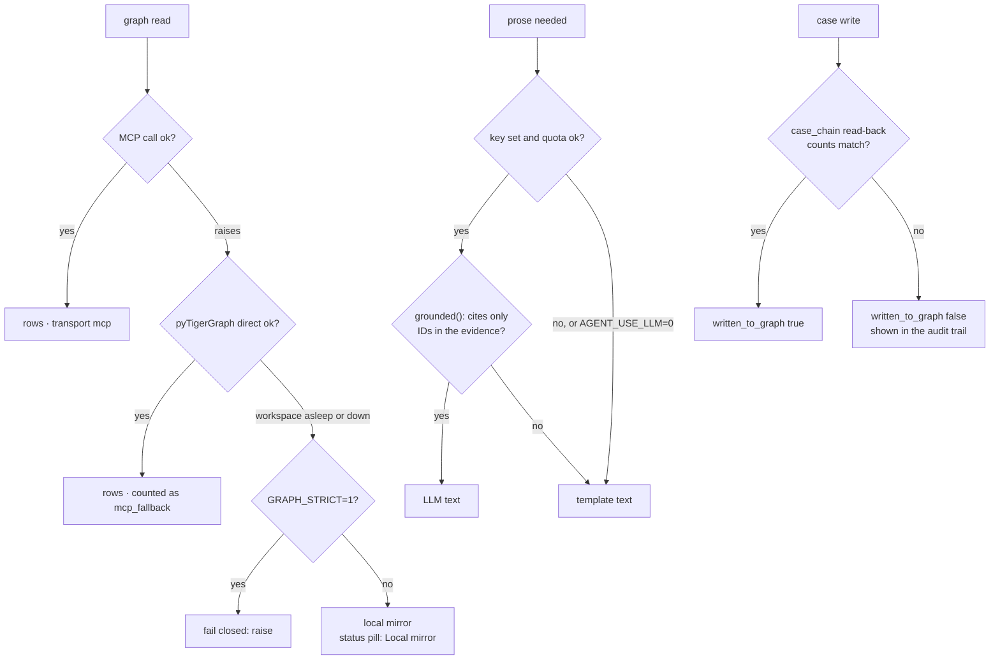

- **Verdicts never depend on the LLM.** With or without a key the twenty answers are identical except for prose.

---

## The one idea

Everything that has to be defensible is deterministic, and everything that has
to be readable is generated.

```
┌──────────────────────────────────────────────────────────────────────────┐
│  LAYER 6 — ANALYST CONSOLE  (FastAPI + vanilla JS, no build step)       │
│  Home · Cases (overview, evidence, graph, similar cases, audit trail) ·  │
│  Scoreboard with audit · Approvals · Monitoring · Insights ·             │
│  live re-run over SSE · replay stepper · zoomable case subgraph         │
├──────────────────────────────────────────────────────────────────────────┤
│  LAYER 5 — ORCHESTRATION  (LangGraph, typed state, capped loop)         │
│  trigger → case opener → planner → retrieval → memory → policy grounding │
│  → ledger → uncertainty → [provisional → evidence request ⟲ ×3]          │
│  → action recommender → permission gate → explainer → case writer        │
│  → read-back verification → memory consolidator                          │
├──────────────────────────────────────────────────────────────────────────┤
│  LAYER 4 — DETERMINISTIC CORE  (pure Python, no LLM imports, tested)     │
│  Bayesian evidence ledger (28 measured signals) · Value of Information · │
│  policy-as-code (R1–R10, §3a, §6) · approval routing ·                   │
│  two-sided stopping rule · episode reconstruction ·                      │
│  hash-chained decision log                                               │
├──────────────────────────────────────────────────────────────────────────┤
│  LAYER 3 — TOOL LAYER                                                   │
│  GraphStore interface (one contract, two backends) ·                     │
│  gateway → TigerGraph MCP server (tigergraph-mcp, stdio, 69 tools) ·     │
│  direct pyTigerGraph fallback per call · simulated action service        │
├──────────────────────────────────────────────────────────────────────────┤
│  LAYER 2 — GSQL INVESTIGATION TOOLKIT  (21 installed queries)           │
│  card_baseline · episode_window · device_fanout · peer_purchases ·       │
│  shared_entity_ring · fraud_proximity · typology probes ·                │
│  behavioural_neighbours · policy_retrieve · hybrid_case_recall ·         │
│  card_community · case_chain · case_write_links                          │
│  GDS (GDBMS_ALGO): WCC + PageRank over ANON_CO_OCCURS                    │
├──────────────────────────────────────────────────────────────────────────┤
│  LAYER 1 — TIGERGRAPH SAVANNA 4.2.5  (graph + TigerVector, one store)   │
│  transaction subgraph · memory subgraph · FraudCase subgraph ·           │
│  vectors: case narratives (384d) · policy text (384d) ·                  │
│           transaction behaviour (64d, engineered)                        │
└──────────────────────────────────────────────────────────────────────────┘
```

Layer 4 contains every decision a bank would have to justify: the risk
arithmetic, the policy enforcement, the approval routing, the stopping rule.
None of it can call a model, and `tests/test_core.py::test_core_cannot_import_an_llm`
walks the AST of every file in `core/` and fails the build if that ever changes.

The LLM plans which primitives to run, synthesises evidence into prose, writes
the case summary and the SAR narrative, and describes an undocumented pattern in
its own words. It never produces a probability, an action, an approval route, an
exposure figure or a transaction id. If it proposes an action anyway,
`PolicyDecision.filter` drops it before it can reach an answer file.

---

## 1. Graph schema

### Transaction subgraph — loaded from the dataset

| Vertex | Primary id | Notable attributes |
|---|---|---|
| `Transaction` | `txn_id` | `ts`, `amount`, `product_cd`, `channel`, `risk_score`, `region`, `device_status` (id_15), `proxy` (id_23), `m_mismatch_count`, `behaviour_emb` **(vector, 64d)** |
| `Card` | `card_id` | `brand`, `card_type`, amount distribution, `home_region`, `community_id`, `hub_rank` |
| `Customer` | `customer_id` | `n_cards`, tenure |
| `DeviceProfile` | `DeviceInfo \| OS \| browser \| screen` | `n_cards`, `n_customers`, first/last seen |
| `BillingRegion` | `addr1` | `country`, `n_cards` |
| `EmailDomain` | domain | `is_free` |
| `ClosedCase` | `case_id` | `outcome`, `pattern`, `exposure_usd`, `narrative`, `narrative_emb` **(vector, 384d)** |
| `Pattern` | `pattern_id` | `source` (DOCUMENTED / **DISCOVERED**), `historical_precision`, `desc_emb` **(vector)** |
| `PolicyDoc` | `doc_id` | `kind`, `section`, `text`, `text_emb` **(vector, 384d)** |

Edges: `MADE_WITH`, `OWNED_BY`, `FROM_DEVICE`, `BILLED_IN`, `PURCHASER_EMAIL`,
`RECIPIENT_EMAIL`, `NEXT_TXN`, plus the closed-case links `CC_INVOLVES`,
`CC_ON_CARD`, `CC_CONNECTED_TO`, `CC_ON_DEVICE`.

`CO_OCCURS_WITH` is a **derived projection**: Card ↔ Card through a shared
device profile, carrying `weight`, `shared_device`, the window it spanned and
`via_anon_proxy`. It collapses a four-hop path into one, which is what makes
ring detection and the GDS algorithms cheap enough to run inside a live demo.
Generic browser fingerprints (>150 cards over six months) are excluded at build
time, because projecting them produces a hairball in which every card is
connected to every other card.

### Case subgraph — written by the agent

`FraudCase` (renamed from `Case`, a reserved word on 4.2) · `Evidence` · `Finding` · `Decision` · `RecommendedAction` ·
`EvidenceRequest` · `SAR` · `Analyst`

This is the part a judge can inspect. `case_chain(graph_case_id)` walks
`Case → Evidence → Finding → Decision → RecommendedAction → SAR` and
reconstructs the whole investigation from the database, without opening the JSON.
Both are written from the same payload in `report/answer.py`, so they cannot
drift apart.

---

## 2. Two embedding spaces, one database

| Vector | Dim | Built from | Answers |
|---|---:|---|---|
| `ClosedCase.narrative_emb` | 384 | 5,565 analyst narratives + their structured facts | "have we investigated something that *reads* like this?" |
| `PolicyDoc.text_emb` | 384 | policy clauses, typologies, regulatory references | "which rule governs this?" |
| `Transaction.behaviour_emb` | **64** | **engineered, not textual** | "which confirmed-fraud transactions *behave* like this one?" |

The behaviour vector is the interesting one. `V1`–`V339` carry real Vesta signal
and are hopeless as LLM context — 339 unnamed columns is not evidence, it is
noise with a schema. Compressed by incremental PCA to 24 components and
concatenated with rank-normalised `C1`–`C14`, `D1`–`D15`, the `M` trinary flags
and amount/velocity features, they become a retrieval key: a nearest-neighbour
query over confirmed-fraud transactions, grounded in data rather than in a
model's impression of a table.

Having both spaces *in the same store as the graph* is the reason this project
belongs on TigerGraph rather than on a graph database plus a vector database.

---

## 3. The signature query

Pure vector search returns cases that *sound* similar. Pure traversal returns
cases that are *connected*. Neither is what an analyst means by "have we seen
this before".

```gsql
candidates = vectorSearch({ClosedCase.narrative_emb}, query_vec, k * 8);
candidates = SELECT c FROM candidates:c WHERE c.opened_at < as_of
             ACCUM @@vec_score += (c -> c.@distance);

linked_d = SELECT c FROM seed_dev:v -(CC_DEVICE_OF:e)- ClosedCase:c
           WHERE c.opened_at < as_of
           ACCUM @@shared += (c -> 1);

result = SELECT c FROM (candidates UNION linked_t UNION linked_c UNION linked_d):c
         ACCUM c.@score += 0.55 * @@vec_score.get(c)
                         + 0.45 * (1.0 - exp(-0.6 * @@shared.get(c)))
         ORDER BY c.@score DESC LIMIT k;
```

Two details carry their weight. The saturating term on the graph leg means the
first shared entity is worth a lot and the fourth is worth very little, so one
busy device profile cannot dominate the ranking. And the `as_of` guard is on
**both** legs — a memory system that can retrieve a case opened after the one it
is reasoning about is not a memory system, it is a leak, and every number
downstream of it is fiction.

---

## 4. The uncertainty engine

### Hypothesis space

Seven competing explanations, which are exactly the enum the answer file is
scored on, so nothing is lost in a mapping step:

`none` · `card_testing` · `card_not_present_fraud` ·
`card_not_present_new_device` · `out_of_region_use` · `account_takeover` ·
`undocumented`

The prior is conditioned on **how the alert arrived**, not on the model's score:
a proactive customer dispute and a risk-score alert have genuinely different base
rates, and the dataset states outright that above 0.70 most flagged transactions
turn out legitimate.

### Where the likelihood ratios come from

1. **Measured** — every closed investigation replayed through the same extractor
   the agent uses, under its own `as_of`. See `eval/reports/calibration.md`.
2. **Structural** — hard matchers for the two undocumented typologies, whose
   signature is near-deterministic and whose support in the history (5 and 4
   cases) is too thin for a smoothed estimate to carry.
3. **Solicited** — customer and step-up responses, entered with an explicit
   reliability below 1.0, because customers forget and channels fail.

An LLM is never permitted to emit a likelihood ratio. It would produce
confident-looking floats with no basis, and the reliability curve would expose it.

### Two calibration traps, and what they cost

Both were found by measuring, not by reasoning, and both inverted the agent
before they were fixed.

**Selection.** Calibrating straight off the closed-case file makes every signal
point the wrong way. Every *cleared* case in the history got there by scoring
high on the bank's model — it is a travel trip, a new phone, an unusual but real
purchase. Every *confirmed* case got there because a cardholder rang up, and
those are often small, ordinary-looking transactions. So inside that file "looks
anomalous" predicts **cleared**, and an agent trained on it learns to wave fraud
through. The fix is a third stratum: ordinary transactions from the same four
months that no investigation ever touched.

**Confounding.** An unmatched negative sample is confounded by card tenure.
Confirmed-fraud cases sit disproportionately on long-lived, busy cards, so "the
device and region are already established" comes out *correlated with fraud*.
The fix is a matched control design — each fraud case paired with another
transaction **on the same card** — which turns the question into the one an
analyst actually asks: what is different about *this* transaction compared with
the rest of this card's behaviour?

### The episode window

Anomaly is measured as **suspect window against established baseline**, never
against the card's whole history up to the alert. Measuring against everything
lets the first legs of a fraud episode teach the baseline that the new device
and the new region are normal, so by the time the alert fires nothing looks
unusual. The baseline cutoff is `as_of − 72h`; 75% of closed-case episodes open
within 29 hours of their alert.

### Stopping — two-sided

1. **Decisive** — belief clears the threshold the required action class demands,
   with enough separation from the runner-up, on at least two independent pieces
   of evidence (policy §6's own wording).
2. **Exhausted** — no permitted evidence action carries enough information per
   unit of friction to justify asking.

The second is the one that matters. Almost any agent can stop when confident.
Stopping because *further investigation would not repay its cost* is a different
and more defensible claim, and it is what a real fraud desk does.

### Value of Information

Each evidence action is scored by expected reduction in Shannon entropy over the
hypothesis space, divided by its **friction** cost — not its monetary cost.
Pinging a cardholder at two in the morning has a real price even though the API
call is free. The policy gate applies to *asking* as well as acting, so the agent
can say: the highest-value next step is customer validation, but the contact
limit forbids a third contact this week, so I am escalating instead.

---

## 5. Policy as code

The bank's policy ships as prose. Prose in a prompt is a suggestion. Rules
R1–R10, the case-versus-report test in §3a and the stopping conditions in §6 are
implemented as pure functions over case state, each carrying the clause id it
enforces and the verbatim source text it was compiled from — loaded at runtime
from `data/policy/chunks.jsonl`, so a citation cannot drift from the document it
claims to quote.

The agent chooses only from `permitted ∪ required`. Approval routing lives in
`core/permissions.py` and is pure data plus arithmetic. An agent that can be
*argued* into executing a block is not a control.

---

## 6. Repository layout

```
ingest/       01 normalise · 02 behaviour vectors · 03 policy corpus
              04 memory index · 05 calibrate · 06 stage graph CSVs · 07 verify
graph/        ddl/ · loading/ · queries/ · algorithms/ · install.py
src/fraudagent/
  config.py           every tunable dial, env-overridable
  graphstore/         base.py (contract) · local.py (mirror) · tigergraph.py
                      matchers.py (window logic shared by both backends)
  core/               hypotheses · signals · evidence_ledger · voi · stopping
                      policy_engine · permissions · episode · ledger
  agent/              graph.py (LangGraph) · nodes.py · state.py
                      llm.py · simulator.py
  memory/             embeddings.py
  report/             answer.py (schema + validation) · narrative.py
  mcp_servers/        simulated_actions.py
eval/         backtest.py → reports/
benchmark/    run_20.py → cases/ · monitor.py → autonomous/
ui/           server.py + static/
tests/        core purity, policy, stopping, VoI, ledger, matchers,
              answer schema, backend parity
```

---

## 7. What is deliberately not built

- **No custom fraud classifier.** There are no labels to train one on, and the
  bank's score is given. The value added here is investigation and action.
- **No real external identity or IP lookups.** The data is anonymised; `card1`
  is a surrogate integer and there are no real IPs. A live lookup returns noise
  dressed as evidence. The stubs are deterministic and say so in every receipt.
- **No production auth in the console.** Roles are a dropdown.
- **No multi-model routing.** Not a rubric item, and the model is not on the
  critical path.
