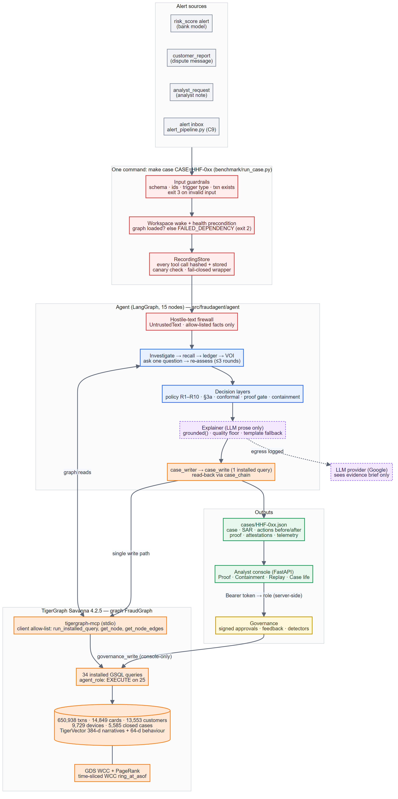
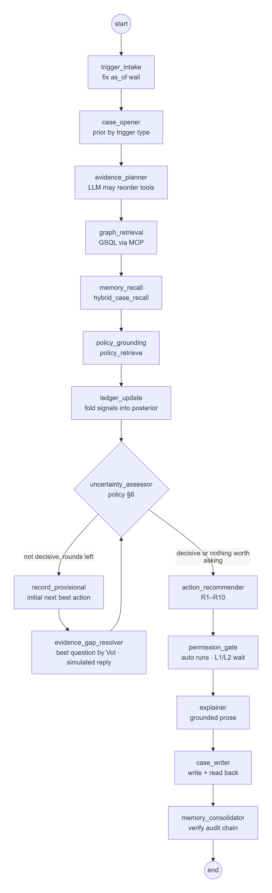
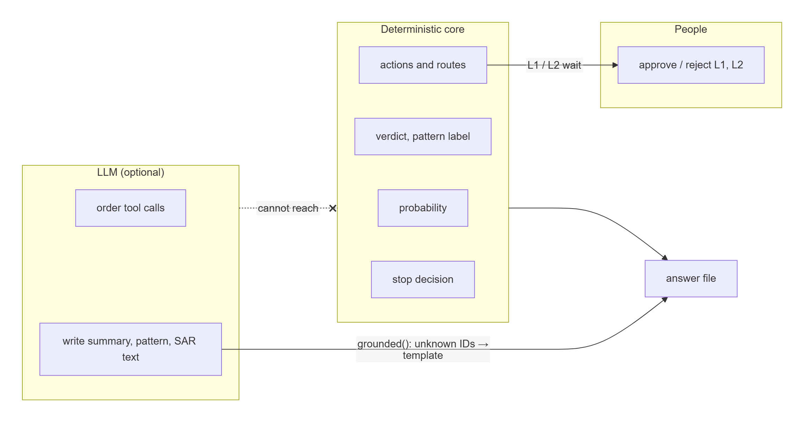
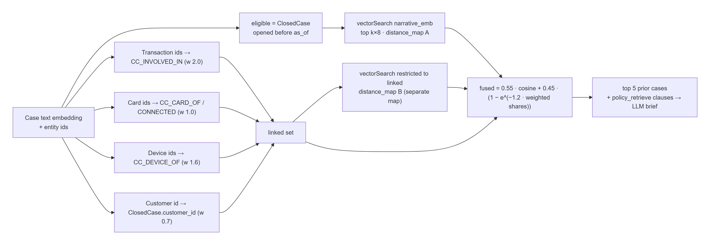
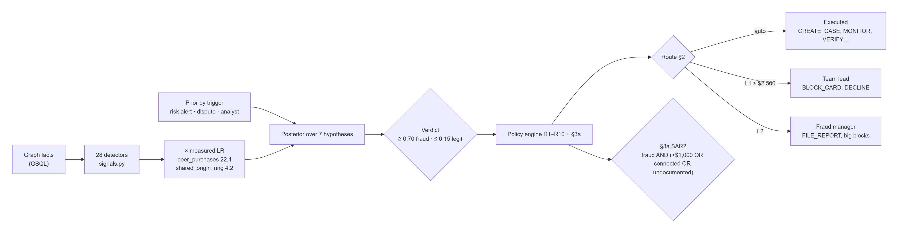
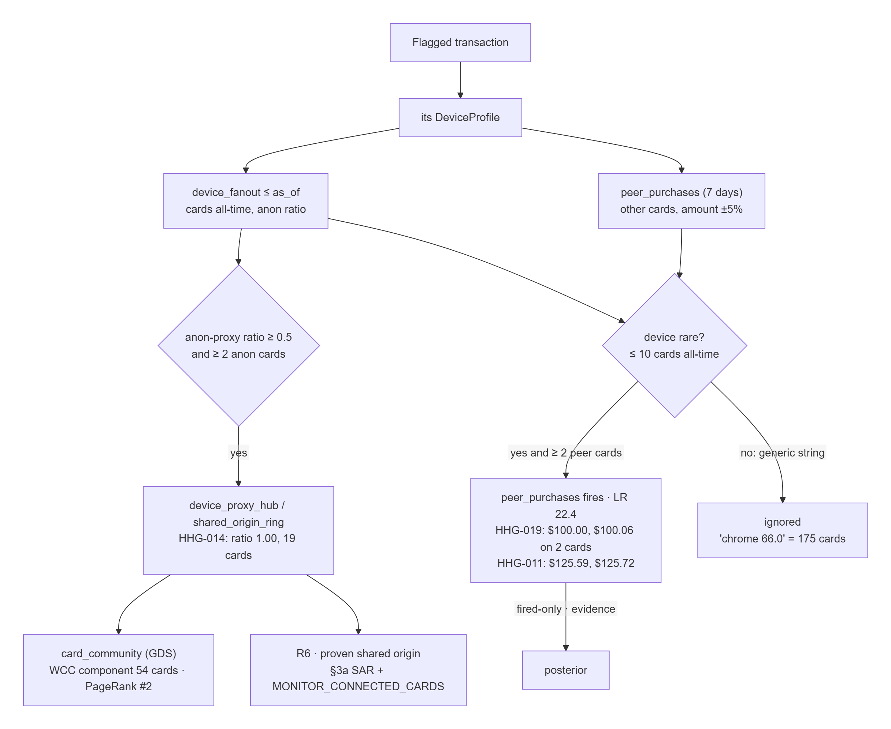
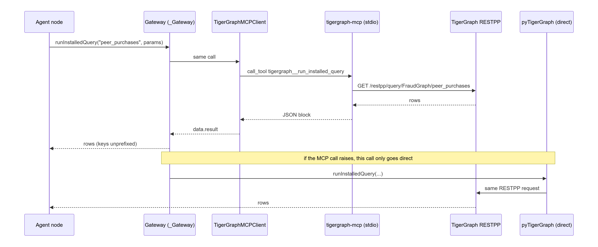
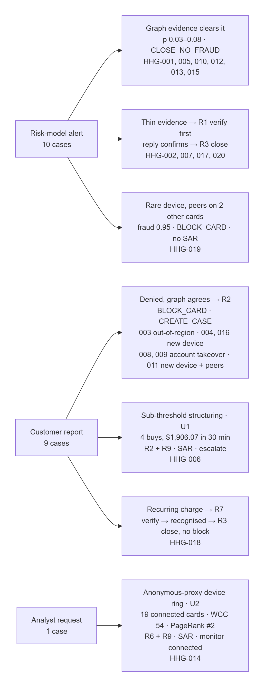
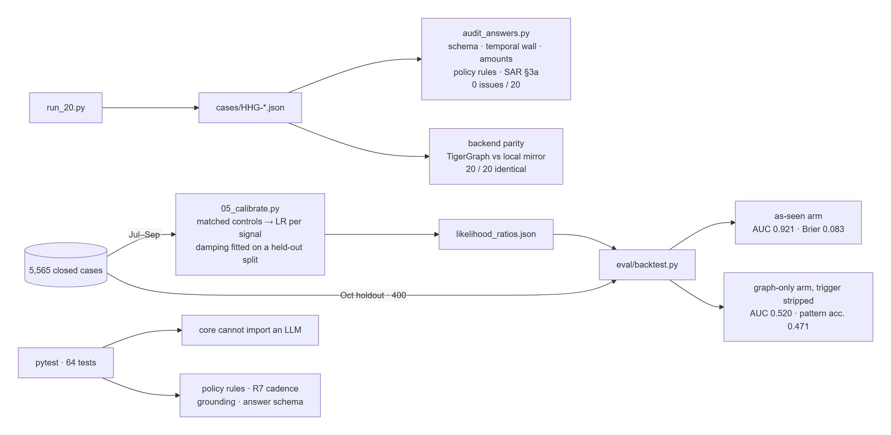

<!--
  Before publishing:
  1. In the dev.to editor, upload each ./diagrams/*.png (image button, or drag
     and drop) and replace each ./diagrams/... path with the URL dev.to returns.
  2. Set Share -> "anyone with the link" on the diagrams artifact, or readers
     will hit a sign-in wall.
  3. Remove this comment. Set published: true when ready.
-->
*Building an agentic fraud investigator on TigerGraph — and the two measurement
mistakes that silently inverted it.*

---


> **All 18 architecture diagrams, interactive:** [FraudGraph Blueprints](https://claude.ai/artifact/VioVT79phoeLTjBKkMWRvb):
> system, agent loop, MCP path, schema, GraphRAG, policy rules, all twenty
> benchmark cases, evaluation and failure modes.
>
> **Try the analyst console:** [prayant-fraudgraph-console.static.hf.space](https://prayant-fraudgraph-console.static.hf.space), all twenty
> investigations with their evidence, graph and audit trail.

## The architecture at a glance


*Three triggers, one LangGraph agent, TigerGraph reached through the MCP server, and a deterministic core the LLM cannot reach.*



*The one conditional edge that makes it an agent: gather more evidence, or act.*


## The problem, stripped down

TigerGraph's Hacker House Goa challenge hands you six months of card
transactions — 590,742 of them, from the IEEE-CIS dataset — and takes away the
one column everyone reaches for. There is no `isFraud` flag. Every transaction
carries a **risk score** from the bank's own model instead, and the dataset
README is blunt about what that score is worth:

> Above 0.7, most flagged transactions turn out to be legitimate. Some fraud
> scores near zero.

What you get instead of labels is four months of **closed investigations** —
5,565 of them, confirmed fraud and cleared false alarms, with the analyst's
notes. And twenty new alerts to decide.

So the task isn't classification. It's investigation: work out what kind of
fraud this is, how far it goes, what to do about it, **and when you know
enough to act**.

That last clause is the whole thing.

---

## The shape that the submission format forces

Buried in the answer format is a requirement that quietly determines the
architecture:

> The next best action and required approval route recorded: **before** any
> additional evidence is requested, **after** any additional evidence is
> received.

You cannot produce that pair honestly from a single-shot pipeline. There is no
"before" unless the agent genuinely commits to a recommendation under
uncertainty, *then* decides what it needs, *then* revises. So the topology is:

```
retrieve → believe → is this defensible?
                          │ no
                          ▼
              PROVISIONAL action + approval route
                          │
              pick the question worth asking
                          │
                      response
                          │
                          ▼
              REVISED action + what changed
```

Everything else follows from wanting that loop to be honest.

---

## The split: what may hallucinate, and what may not


*The model sits outside the decision boundary; people sit on the approval boundary.*

Every decision a bank would have to justify to a regulator lives in a
`core/` package that **cannot import an LLM**. Not "does not" — cannot. A test
walks the AST of every file in that directory and fails the build if an import
of `anthropic`, `openai`, `langchain` or anything with `llm` in the name ever
appears:

```python
def test_core_cannot_import_an_llm():
    banned = {"anthropic", "openai", "google", "langchain", "langgraph", ...}
    for path in (ROOT / "src" / "fraudagent" / "core").glob("*.py"):
        tree = ast.parse(path.read_text())
        ...
    assert not offenders, f"core/ must stay LLM-free: {offenders}"
```

That covers the Bayesian ledger, the policy engine, the approval routing, the
stopping rule and the episode reconstruction. The model plans which graph
primitives to run, synthesises evidence into prose, writes the case summary and
the SAR narrative. If it proposes an action anyway, the policy decision object
drops it before it can reach an answer file.

The practical consequence, which I like more than the principle: the agent runs
end to end with **no API key at all**. Verdicts, probabilities, actions and
approval routes are bit-identical; only the wording changes. Anyone can clone
the repo and reproduce the twenty answer files without buying anything.

---

## What TigerGraph is actually for here


*Similar past cases found by meaning and by shared entities inside one GSQL query, then fused.*

The obvious answer is "traversal", and that's true — but the reason this project
belongs on a graph database with vectors *in the same store* is a query that
needs both at once.

Case memory is the requirement: prior closed cases must measurably change what
the agent concludes. The naive implementations both fail in the same
characteristic way:

- **Vector search alone** returns prior cases that *sound* similar. Narratives
  are templated, so it happily returns five cases about card testing when you
  asked about a different burst pattern.
- **Traversal alone** returns cases that are *connected* — same card, same
  device, same customer. Precise, and usually empty.

Neither is what an analyst means by "have we seen this before". So fuse them, in
one GSQL statement, inside the database:

```gsql
candidates = vectorSearch({ClosedCase.narrative_emb}, query_vec, k * 8);
candidates = SELECT c FROM candidates:c WHERE c.opened_at < as_of
             ACCUM @@vec_score += (c -> c.@distance);

linked_d = SELECT c FROM seed_dev:v -(CC_DEVICE_OF:e)- ClosedCase:c
           WHERE c.opened_at < as_of
           ACCUM @@shared += (c -> 1);

result = SELECT c FROM (candidates UNION linked_t UNION linked_c UNION linked_d):c
         ACCUM c.@score += 0.55 * @@vec_score.get(c)
                         + 0.45 * (1.0 - exp(-0.6 * @@shared.get(c)))
         ORDER BY c.@score DESC LIMIT k;
```

Two details do real work. The **saturating** term on the graph leg means the
first shared entity is worth a lot and the fourth almost nothing — with a linear
term, one busy device profile dominates every ranking. And the `as_of` guard on
**both** legs: a memory system that can retrieve a case opened after the one
it's reasoning about isn't a memory system, it's a leak, and every number
downstream of it is fiction.

There's a second embedding space too, and it's the one I'd defend hardest.
`V1`–`V339` are Vesta's engineered features: real signal, no names, and utterly
hopeless as LLM context. 339 unnamed columns isn't evidence, it's noise with a
schema. Compressed by incremental PCA to 24 components and concatenated with
rank-normalised count and time-delta columns, they become a **64-dimensional
behaviour vector** stored on every `Transaction`. Now "which confirmed-fraud
transactions *behave* like this one" is a vector query grounded in data, rather
than a language model's impression of a table.

---

## Mistake one: the closed-case file is not a sample of alerts

Here's the part I'd want to read in someone else's write-up.

The plan was to measure likelihood ratios instead of guessing them: replay all
5,565 closed investigations through the same extractor the agent uses, under
each case's own `as_of`, and count. Real numbers from real outcomes.

The first run produced this:

| signal | P(s \| fraud) | P(s \| cleared) | LR |
|---|---:|---:|---:|
| `known_device_and_region` | 0.610 | 0.188 | **3.30** |
| `amount_typical` | 0.394 | 0.150 | **2.63** |
| `device_new_on_account` | 0.134 | 0.484 | 0.28 |
| `amount_anomalous` | 0.078 | 0.125 | 0.62 |

Read that carefully. It says a transaction on a **known device, in a known
region, for a typical amount** is over three times more likely to be fraud. And
that a large, anomalous purchase from a brand-new device is *evidence of
legitimacy*.

Which is, taken at face value, insane. And the agent believed it completely —
93% held-out accuracy, beautiful Brier score, and on the benchmark it confidently
called quiet, ordinary transactions fraud while clearing the obvious ones.

The bug isn't in the modelling. It's in what the closed-case file *is*.

Every **cleared** case in that history got there by scoring high on the bank's
model. It's a travel trip, a new phone, an unusual but genuine purchase — an
investigation that happened *because* the transaction looked strange. Every
**confirmed** case got there because a cardholder phoned up about a charge they
didn't recognise, and those are frequently small and unremarkable.

So inside the closed-case file, "looks anomalous" genuinely does predict
*cleared*. The measurement was correct. The population was wrong.

The fix is a third stratum the file doesn't contain: **ordinary transactions
from the same four months that no investigation ever touched.** Because months
1–4 were fully worked by the bank's analysts, an untouched transaction there is
a usable negative — and now the negative class represents non-fraud rather than
representing false alarms.

---

## Mistake two: unmatched negatives are confounded by card tenure

Adding untouched negatives helped, and did not fix it. `known_device_and_region`
came down to LR 1.56 — still pointing the wrong way.

The remaining confound is the card, not the transaction. Confirmed-fraud cases
sit disproportionately on **long-lived, busy cards**: more history, therefore
more established devices and regions, therefore "the device and region are
already established" correlates with fraud through a variable that has nothing
to do with fraud.

The fix is a **matched control design**. For each confirmed-fraud case, draw
another transaction **on the same card** as its control. The card-level confound
cancels exactly, and the question the calibration answers becomes the question
an analyst actually asks:

> What is different about *this* transaction compared with the rest of this
> card's behaviour?

## And then the uncomfortable part

With both corrections in, held-out fraud-versus-not accuracy went from **0.93 to
0.57**, and most of the likelihood ratios collapsed to about 1.

My first instinct was that I'd broken something. I hadn't. That number is the
data answering the question I'd finally asked correctly.

Every confirmed case in this history was found by a cardholder ringing up. Fraud
never entered that file *because it looked anomalous* — it entered because
someone noticed a charge. So once you remove the trigger as a feature, which you
must because it is perfectly confounded with the outcome, the graph signals
genuinely cannot separate confirmed fraud from ordinary activity on the same
card. Most fraud in this dataset is small and unremarkable. That is the point.

The 0.93 was the artefact. The 0.57 is the finding.

What the history *can* teach is which typology a fraud is, and it teaches that
strongly:

| signal | CNP-new-device | out-of-region | account takeover |
|---|---:|---:|---:|
| `device_new_on_account` | **0.85** | 0.001 | 0.07 |
| `match_flag_anomaly` | 0.001 | **0.56** | 0.47 |
| `online_burst_2_to_4` | **0.43** | 0.001 | 0.04 |
| `known_device_and_region` | 0.14 | **0.86** | 0.75 |

So the architecture follows the evidence rather than the other way round:
fraud-versus-not is carried by the trigger prior and by the structural typology
matchers; *which* typology is carried by the measured table. I'd rather ship
that with the 0.57 written on the tin than ship the 0.93 and let the reliability
curve look excellent right up until the agent clears a real fraud for being
unremarkable.

Three lessons I'd take anywhere, not just here:

1. **A held-out accuracy number will not save you.** Ours was 93% while the
   agent was systematically inverted. The metric was faithfully measuring how
   well we'd learned a selection effect.
2. **Look at the sign, not just the size.** The clue was never the accuracy. It
   was one likelihood ratio pointing in a direction no fraud analyst would
   accept.
3. **A metric getting worse can be the fix landing.** If you only ever ship
   changes that move the number up, you will ship the bias.

---

## Mistake three, smaller: the episode teaches its own baseline

Related, and worth thirty seconds. If you measure "is this device new to the
card" against the card's whole history up to the alert, the **earlier legs of
the same fraud episode** are in that history. The first fraudulent transaction
teaches the baseline that the new device is normal, and by the fourth one
nothing looks unusual at all.

So anomaly is measured as **suspect window against established baseline**, with
the baseline cut off 72 hours before the alert. Seventy-five percent of
closed-case episodes open within 29 hours of their alert, so the window catches
the tail without swallowing ordinary history.

---

## The two fraud patterns that aren't in the documentation

The dataset drops a deliberate hint:

> Not every fraud pattern present in the data is documented.

Five typologies are described. Nine closed cases are marked `undocumented` —
confirmed fraud the bank's own analysts could not categorise. Their narratives
split cleanly into two signatures, and both turn up in the graded twenty.

**U1 — sub-threshold authorisation structuring.** Four online purchases inside
roughly forty minutes, each amount parked just beneath a $500 authorisation
ceiling, about $1,900 in total. It's invisible to per-transaction scoring
because *every individual leg looks completely ordinary*. It only exists as a
property of the burst. **HHG-006** in the benchmark is one: $478.95, $456.96,
$488.04, $482.12 in thirty minutes, $1,906.07 total — against five closed cases
between $1,871 and $1,922.

**U2 — a shared-device ring behind an anonymising proxy.** One device profile
across a run of unrelated cardholders in a single month, marked new on every
account it touches. **HHG-014** is one of these; the analyst request that
triggers it even says so.

The detection subtlety on U2 is the bit I'd put on a slide. A "device profile"
in this dataset is a `DeviceInfo | OS | browser | screen` string — a model, not
a serial number — and **92% of online transactions sit on a profile shared by
three or more cards**. Counting cards per device finds nothing but noise, and a
naive fan-out rule fired on half the benchmark.

What separates a real hub is the **anonymous-proxy ratio**:

| device profile | cards | via anonymous proxy | ratio |
|---|---:|---:|---:|
| `SM-G935F \| Android 7.0 \| chrome 62.0 \| 1920x1080` | 52 | 52 | **1.00** |
| `Windows \| Windows 10 \| chrome 65.0 \| 1920x1080` | 300 | 9 | 0.03 |
| `Trident/7.0 \| Windows 10 \| ie 11.0 \| 1920x1080` | 253 | 14 | 0.06 |

Every card that ever touched the ring device arrived anonymously. That is not a
household sharing a tablet.

---

## Choosing *what* to ask, not just *that* you need more


*Evidence becomes numbers through measured likelihood ratios; numbers become actions only through the written policy.*

When belief won't support a defensible action, the agent has to pick one
evidence action. Picking the strongest is wrong; picking the best information
per unit of **friction** is right — and friction is not money. Pinging a
cardholder at two in the morning has a real cost even when the API call is free.

Each candidate is scored by expected reduction in Shannon entropy over the
hypothesis space, divided by its friction cost, and filtered through the policy
**first** — because the policy constrains *asking*, not only acting. That lets
the agent produce a sentence I'm fond of:

> The highest-value next evidence is customer validation, but the contact-fatigue
> limit forbids a third contact this week, so I am escalating to an analyst
> instead.

That single sentence demonstrates uncertainty handling, policy compliance, next
best action and explainability at once.

And the stopping rule is two-sided. Anyone can stop when confident. The second
condition is the one that matters:

> No permitted evidence action carries enough information per unit of customer
> friction to justify it. Further investigation would not change the decision, so
> the case goes to a human with what is known.

That's a different and more defensible claim than "I'm sure", and it's what a
real fraud desk does.

---

## Two cases the first build got wrong, and how the data said so


*HHG-018: a disputed charge the card has paid 21 times. Asked first, recognised, closed without a block.*


*Rings you can't see from one card: gated so a popular browser string never becomes a false ring.*

After the first complete build I read ten other teams' write-ups for the same
brief. Two disagreements with my answers were worth checking against the data.

**HHG-019 is a ring you can't see from one card.** It is a risk-model alert, and
this history's risk-model alerts are almost always false alarms (900 of 900
cleared). But ask what happened on *other* cards: the flagged purchase's device —
a profile only three cards had ever used — bought $100.00 and $100.06 on two other
cards that week. `peer_purchases.gsql` is that two-hop question. The gate matters
more than the query: on a generic browser string ("chrome 66.0", 175 cards)
ordinary shoppers with similar baskets would make a false ring, so it only fires
on a rare device. Its weight is measured, not chosen. It fired on 31
confirmed-fraud closed cases and no cleared ones, a likelihood ratio of 22.4,
the strongest in the model.

My first version of it made two mistakes, and the October holdout caught both.
It treated the peer cards as *connected cards*, which switched on R6 and the
filing rule — and filed 19 reports on holdout cases the bank itself never
reported. And it folded in "did not fire" on every other case, which nudged
each one away from card-not-present fraud and cost nineteen correct pattern
calls. Both fixes are about what the evidence actually proves. Peers move the
probability; they don't prove a shared origin, so R6 and the report still need
one. And the absence of a rare hub is not a finding, so the signal is
fired-only. HHG-019 now ends as fraud at 0.95, card blocked, and no report:
$99.92 on one card with a documented pattern meets none of §3a's conditions.

**HHG-018 is a subscription the cardholder forgot.** The disputed $39.08 charge
appears on the card 21 times since July, every one to three weeks. R7 exists for
exactly this. The first fix — "four identical charges over six weeks is a habit"
— was wrong, and the October backtest said so: it fired on 15 disputes, 14 of
them confirmed fraud, because a fraud episode repeats an amount too, in a burst
(one had 21 charges 2.8 days apart). The rule that survives needs a quarter of
steady history: at least eight charges over 90 days or more, a median gap of 5
to 35 days. A burst can't fake that; HHG-018 clears it easily. The simulated
reply follows R7's own premise — the cardholder recognises the charge — and the
answer file says so.

The lesson is the same one as the calibration trap: measure the change against
data it could be wrong on, not only the case it was written for.

---

## Reaching the graph through MCP, and letting the algorithms speak


*Every graph call goes through the official TigerGraph MCP server first, with a per-call fallback.*

The agent never holds a database connection of its own. It starts the official
`tigergraph-mcp` server over stdio and calls `tigergraph__run_installed_query`,
`get_node`, `add_node` and friends — 1,492 calls on the last full run, zero
fallbacks. A gateway falls back to a direct connection per call, so a flaky
tool call degrades one read, not a case; `GRAPH_STRICT=1` turns that into a hard
failure when you'd rather know.

TigerGraph's GDS library earns its place once you point it at the right
subgraph. WCC over the full card co-occurrence network returns one 6,125-card
blob, held together by popular browser strings. Over the anonymous-proxy slice
(1,725 edges) it isolates the HHG-014 ring as a 54-card component, with the
case's card second by PageRank. That result is all-time structure, so it is
cited next to the time-bounded evidence and never weighed.

---

## Things that turned out to be load-bearing

**`card_id` isn't in the data.** `transactions.csv` has no card column, but the
case pack and the closed cases are expressed entirely as `C01234-K1`. A card is
the `(customer_id, card2..card6)` tuple — but the `K` index isn't derivable from
it, and every obvious ordering tops out near 50% agreement with the labels. The
answer was to stop guessing and *pin* it from the 14,975 transactions the
dataset itself labels. 100% agreement, asserted by a verification step. Get this
wrong and every card-scoped query silently breaks on half the cases.

**Reported probability is capped at 0.97.** `fraud_probability` is explicitly
scored for calibration, and reporting 1.00 isn't confidence — it's a missing
error bar. The ceiling sits above the 0.85 action threshold, so it never changes
an action.

**Every decision is hash-chained.** Edit a recorded rationale after the fact and
`verify()` tells you which link broke.

**A write isn't a write until it reads back.** After writing the case subgraph
the agent walks it with `case_chain` and checks the transactions, connected cards
and SAR landed. `written_to_graph` means read back, not attempted.

**The model may only cite what it was given.** Any LLM-written sentence that
names a case, card or transaction absent from its brief is discarded for the
template. Every evidence item says whether it is a graph fact, an inference, a
model score, policy text or a simulated reply.

---

## Every benchmark case, on one page


*11 legitimate, 9 fraud, 2 SARs, 5 decisions changed after asking one question.*


*Measured on July–September, tested on an October holdout the calibration never saw.*

The other diagrams (schema, case lifecycle, policy rules, console, monitoring, failure modes) are on the [interactive page](https://claude.ai/artifact/VioVT79phoeLTjBKkMWRvb).

## What I'd do with more time

- **Close the memory loop properly.** Cases the agent writes are retrievable by
  the next investigation, but the *likelihood-ratio table* isn't recomputed from
  them yet. Memory that updates the agent's evidence weighting, not just its
  retrieval, is a materially stronger claim.
- **Learn the episode boundary instead of windowing it.** 72 hours is a defensible
  constant fitted to the closed cases; a changepoint model over the card's own
  activity would be better.
- **Propagate the ring.** When U2 fires, every connected card is a case waiting
  to be opened. Right now they're monitored, not investigated.
- **Time-slice the graph algorithms.** WCC and PageRank see all six months, so
  they can only be context. A projection cut at each alert's `as_of` would let
  them count as evidence.

---

## Try it

```bash
python -m pip install -r requirements.txt
make ingest
python benchmark/run_20.py
python eval/audit_answers.py
python ui/server.py
```

No API key, no database, no build step. The model writes the prose; the graph
makes the decisions.

*Repo: `<your-repo-url>` · Built for TigerGraph × Hacker House Goa 2026.
Thanks to @TigerGraphDB for a dataset with real traps in it.*