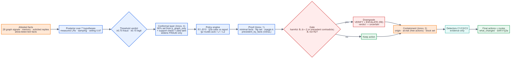

# 03 · Decision layers — from evidence to a defensible action

```mermaid
%%{init: {"theme": "base", "themeVariables": {
  "fontFamily": "Arial", "fontSize": "15px",
  "primaryColor": "#FFF4EC", "primaryBorderColor": "#F58220", "primaryTextColor": "#1F2430",
  "lineColor": "#5B6475", "secondaryColor": "#EEF4FF", "tertiaryColor": "#F6F7F9",
  "clusterBkg": "#FBFBFC", "clusterBorder": "#C9CED6"},
  "flowchart": {"htmlLabels": false, "padding": 18, "nodeSpacing": 45, "rankSpacing": 55}}}%%
flowchart LR
  EV["Attested facts<br/>28 graph signals · memory · solicited replies<br/>allow-listed text facts"]:::tg
  POST["Posterior over 7 hypotheses<br/>measured LRs · damping · ceiling 0.97"]:::core
  V0{"Threshold verdict<br/>≥0.70 fraud · ≤0.15 legit"}:::core
  CF["Conformal layer (Innov. 4)<br/>90% set from p_graph_only<br/>+ support check + data taint<br/>widens FRAUD only"]:::core
  POL["Policy engine<br/>R1–R10 · §3a case vs report<br/>§2 routes auto / L1 / L2"]:::core
  PR["Proof (Innov. 1)<br/>minimal facts · flip set · margin k<br/>precedent_by_facts (GSQL)"]:::core
  GT{"Gate<br/>harmful ＆ (k＜2 or precedent contradicts)<br/>＆ not R2?"}:::guard
  DG["Downgrade<br/>VERIFY + ESCALATE (R8)<br/>verdict → uncertain"]:::guard
  KEEP["Keep action"]:::ok
  CT["Containment (Innov. 2)<br/>origin · at-risk (free actions) · block set"]:::tg
  DET["Detectors C1/C2/C3<br/>evidence only"]:::eval
  OUT["Final actions + routes<br/>what_changed · SAR if §3a"]:::ok

  EV --> POST --> V0 --> CF --> POL --> PR --> GT
  GT -->|yes| DG --> CT
  GT -->|no| KEEP --> CT
  CT --> DET --> OUT

classDef tg fill:#FFE8D6,stroke:#F58220,stroke-width:2px,color:#1F2430;
classDef core fill:#E8F1FF,stroke:#2F6FEB,stroke-width:2px,color:#10233F;
classDef llm fill:#F3E8FF,stroke:#8B5CF6,stroke-width:1.5px,color:#2A1450,stroke-dasharray:4 3;
classDef guard fill:#FFECEC,stroke:#D64545,stroke-width:2px,color:#4A1010;
classDef ok fill:#E9F8EF,stroke:#1E9E5A,stroke-width:2px,color:#0D3B22;
classDef human fill:#FFF8DB,stroke:#C79A00,stroke-width:2px,color:#3A2E00;
classDef data fill:#F1F3F6,stroke:#7A8394,stroke-width:1.5px,color:#1F2430;
classDef eval fill:#E6FAF8,stroke:#0F9D8F,stroke-width:1.5px,color:#08332F;
```

**The property that matters:** every layer after the posterior can only *remove* harm.
Conformal widens a fraud verdict to uncertain; it never creates one. The gate removes a
block or report; strong precedent can never promote an action. Containment's forward actions
are MONITOR_CARD and STEP_UP_AUTH only, which cost a legitimate customer nothing. Detectors
add evidence, never a block.

**R2 exemption.** A cardholder who denied the charge — in reply to our question *or* in the
customer-report text, read by the allow-listed extractor — makes the block mandatory, so the
gate records the margin but does not act, and the conformal layer treats the case as settled.

**Consistency with the grader.** An uncertain case never claims the `undocumented` pattern
(which would oblige a report under R9); a gated or abstained case is not "strongly suspected"
for §3a, and the SAR reason says why.

**Where it changed outcomes in the final pack.** HHF-016 ($3,008.76, hostile "do not
escalate" text): block resting on margin k=1 → downgraded to verify + escalate.

---
[← index](README.md)
