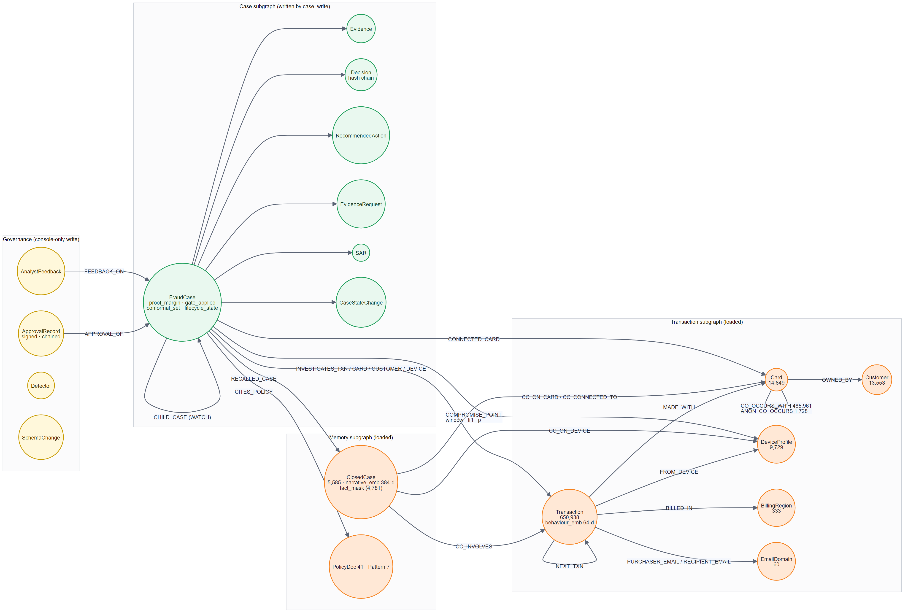
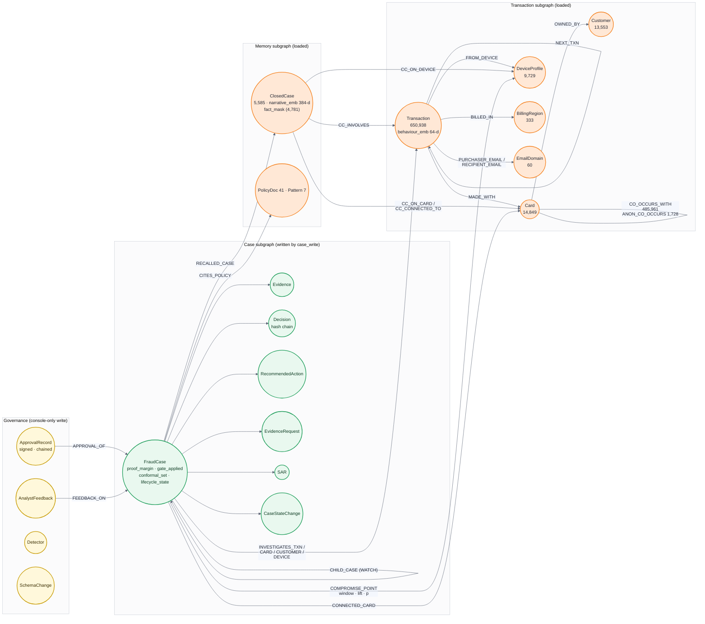

# 04 · TigerGraph schema — the data graph and the case graph

**Three subgraphs in one database.** The *transaction* subgraph is the evidence surface. The
*memory* subgraph holds the bank's 5,585 closed investigations (now including the 20 Round 1
cases with their real outcomes) with 384-d narrative vectors for TigerVector search and a
**fact_mask** bitmask — each closed case's replayed fact vector — so proof precedent is one
GSQL subset match. The *case* subgraph is what the agent writes: an investigation can be
reconstructed by traversal alone (`case_chain`), and the answer only claims
`written_to_graph: true` after that read-back succeeds.

**Final-round additions** (`graph/ddl/06_final_round.gsql`): `ClosedCase.fact_mask`,
`COMPROMISE_POINT` (FraudCase → device / region / email, carrying window, lift and p-value),
`CHILD_CASE` (WATCH children for at-risk cards), `CaseStateChange`, and the governance
vertices `ApprovalRecord`, `AnalystFeedback`, `Detector`, `SchemaChange`.

**Live state at demo time:** 650,938 transactions (Jul 2016 – 31 Jan 2017), 5,585 closed
cases, 20 written FraudCases with 148 evidence items, 50 state changes, a `COMPROMISE_POINT`
from the HHG-014 ring to its origin device, and 25 WATCH child cases.

---
[← index](README.md)
