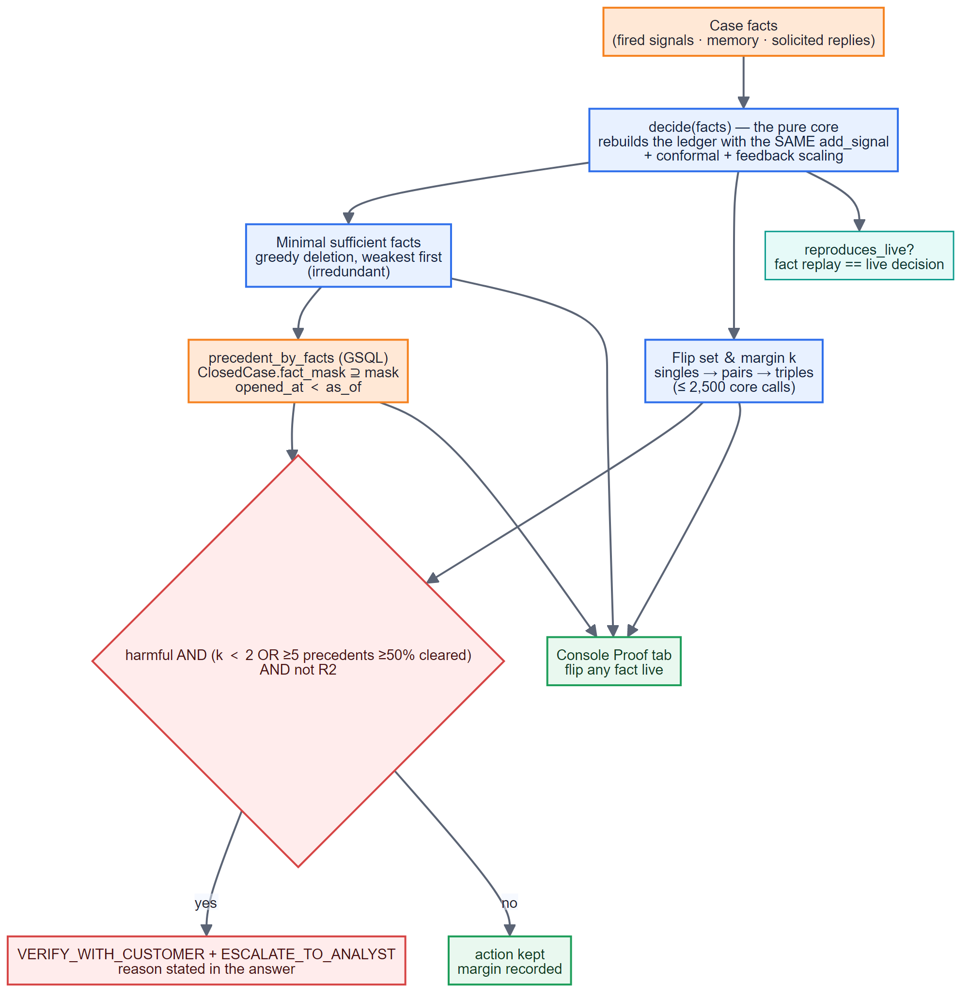
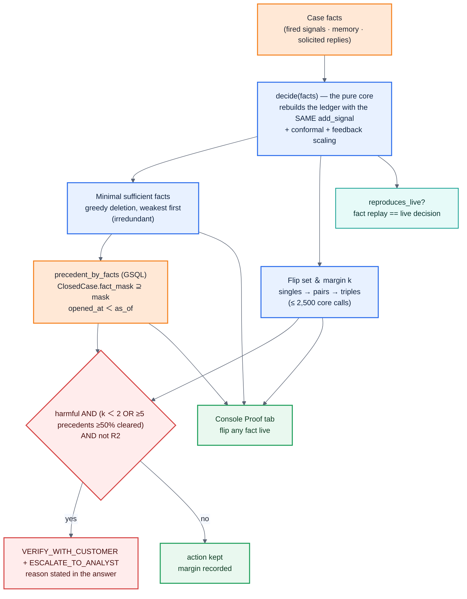

# 06 · Innovation 1 — proof-carrying verdicts

**Claim.** Every answer ships a proof an examiner can check in five minutes: the smallest set
of attested facts that forces the action, the smallest set whose removal flips it (its
robustness margin *k*), and how the bank ruled on closed cases that had exactly those facts. A
harmful action resting on a thin or contradicted proof is downgraded before anyone is wronged.

**Why it can be computed rather than written.** The decision core is a pure function. The
proof replays it through the same `EvidenceLedger.add_signal` the agent used (with the
conformal layer and any analyst-feedback scaling), so it is a proof of the decision actually
taken; `reproduces_live` records that it matched.

**Measured on the October holdout** (fitted on July–September; `eval/reports/proof_holdout.md`):

| | harmful actions | on legitimate cases | error rate |
|---|--:|--:|--:|
| margin k = 1 | 181 | 65 | **0.36** |
| margin k ≥ 2 | 31 | 5 | **0.16** |

| arm | legit customers acted against | frauds acted on |
|---|--:|--:|
| no gate (Round 1) | 70 | 142 |
| margin + precedent (the gate) | **5** | 26 |

Fragility predicts error, so the gate is claimed — and its cost is stated next to it: the
frauds it does not block are escalated (verify + escalate), not dropped. Precedent alone rarely
fires (3 contradictions on the holdout); the margin carries the gate.

**Final pack.** Every one of the 18 answers carries a proof. HHF-016 is the case where the
gate changed the action: a $3,008.76 block resting on k=1 became verify + escalate. HHF-001 and
HHF-002 kept their blocks at k=2 with 1,227 precedents sharing the minimal fact.

---
[← index](README.md)
