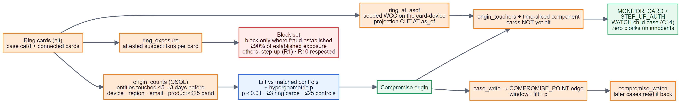
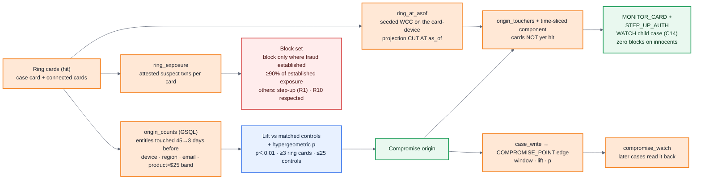

# 07 · Innovation 2 — predictive containment from the point of compromise (C7 + C1)

**Claim.** Containment usually looks backward (block the cards already hit). The bigger saving
is forward: find where the ring was compromised, then protect the cards that passed through the
same point but have not been hit yet, using only actions that cost a legitimate customer
nothing.

**Backtest** (80 rings from the closed history: 6 explicit, 74 implied by shared rare devices;
future data scores, never decides; `eval/reports/containment_backtest.md`):

| arm | flagged | precision | lift | loss pre-empted |
|---|--:|--:|--:|--:|
| device fan-out (obvious) | 100,189 | 0.20 | 2.67× | — (100k step-ups) |
| **origin lift with controls** | 246 | 0.26 | **3.57×** | $193,907 |
| origin by raw counts (ablation) | 39,838 | 0.04 | **0.53×** | — |
| **time-sliced WCC (as_of)** | 23,042 | **0.374** | **5.05×** | $14.41M |
| all-time component (ablation) | 24,826 | 0.354 | 4.78× | $14.91M |
| **agent: origin + time-sliced** | 23,211 | 0.372 | 5.03× | **$14.42M** |

Every arm has **zero blocks on innocent customers** by construction. Two ablations carry the
claim: matched controls are what make an origin usable (0.53× without them), and cutting the
graph at as_of beats the all-time component (higher precision with fewer cards flagged). Honest
note: fan-out over *rare* devices alone scores 0.49 — but these rings are themselves defined by
rare shared devices, so that baseline is favoured by construction.

**Live demo:** HHG-014 (19-card ring behind an anonymising proxy): origin = the SM-G935F device
(lift ≈ 4,946, p < 1e-20), 141 at-risk cards protected with step-up only, 1 block on the
established card, `COMPROMISE_POINT` + 25 WATCH child cases written to the graph.

---
[← index](README.md)
