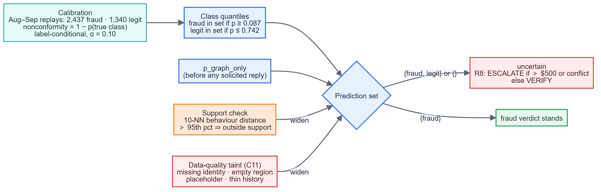
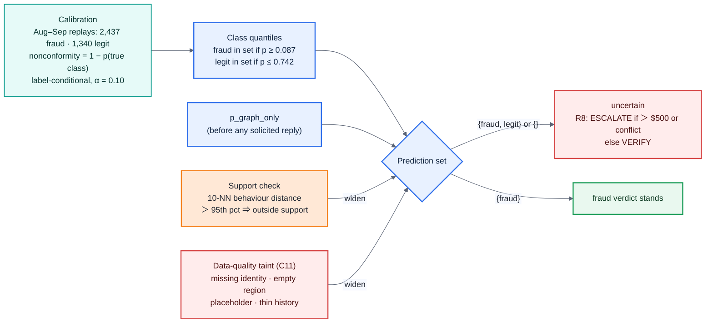

# 08 · Innovation 4 — conformal abstention under the January shift (C11)

**Claim.** "Uncertain" is chosen by a coverage guarantee, not a hand-picked threshold, and it
widens automatically when a case looks like nothing calibration has seen — the brief's warning
that the bank's model has never seen January.

**Measured** (`eval/reports/conformal.md`): October empirical coverage 0.86 overall
(legit 0.94, fraud 0.81) against nominal 0.90. The fraud class under-covers under the
month-to-month shift, and we say so. Mean set size 1.75, so the set is often {fraud, legit},
but it only ever *widens a fraud verdict*; a legitimate verdict that cannot wrong anyone is
reported and left alone.

**January.** For transactions after 2016-12-31 the risk-alert signal that learned "isolated
anomaly = false alarm" carries LR 1, and the risk-score prior is softened from 0.62 to 0.50 — a
low score is not evidence of innocence.

**Taint (C11)** widened the set on 5 of the 18 final cases, all with missing identity records.
For the customer-denial cases among them, R2 still governs (a denial is outside what
calibration saw), so the block stands.

**Caveat stated up front.** The closed cases are a selected sample, so coverage holds for
"cases like the ones the bank investigated", not all traffic.

---
[← index](README.md)
