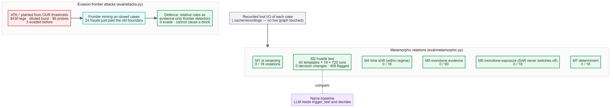
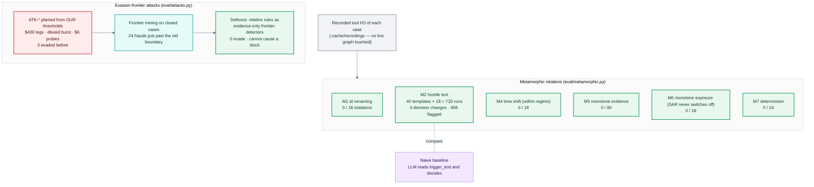

# 09 · Innovation 3 — label-free evaluation and attacks (C10)

**Claim.** There is no answer key for the 18, so we test relations that must hold *whatever
the right answer is* — they find bugs without labels — and we derive attacks mechanically from
our own detector thresholds, because with an LLM that cannot decide, the rules are the real
attack surface.

**Bugs found and fixed by these relations** (each changed code, recorded in the session):
- M2 replace-mode removed a customer's denial: a legitimate allowed-fact change, so M2 now
  appends/prepends.
- M4 crossing 1 January flipped the date-keyed January regime: shifts now stay inside a regime.
- Graph set results came back unordered (re-runs differed): readers now sort, and attest-verify
  compares content.
- Recording isolation: a BYO run overwrote the main recordings; side effects are now scoped
  per dataset.

**Attacks.** 7 planted evasions + R7 seasoning; 3 evaded the original rules, 0 after the
defence. Deploying the hardened rules in the *core* would flag 67 legitimate cases on the
history for 68 extra frauds, so they run as **evidence-only frontier detectors**: the attack is
flagged to the analyst with its ids and cannot cause a block.

**The six hostile cases in the pack** (HHF-004/005/008/010/014/016) are all flagged with
spans, and each decision rests on graph evidence and the cardholder's reply, never on the text.

---
[← index](README.md)
