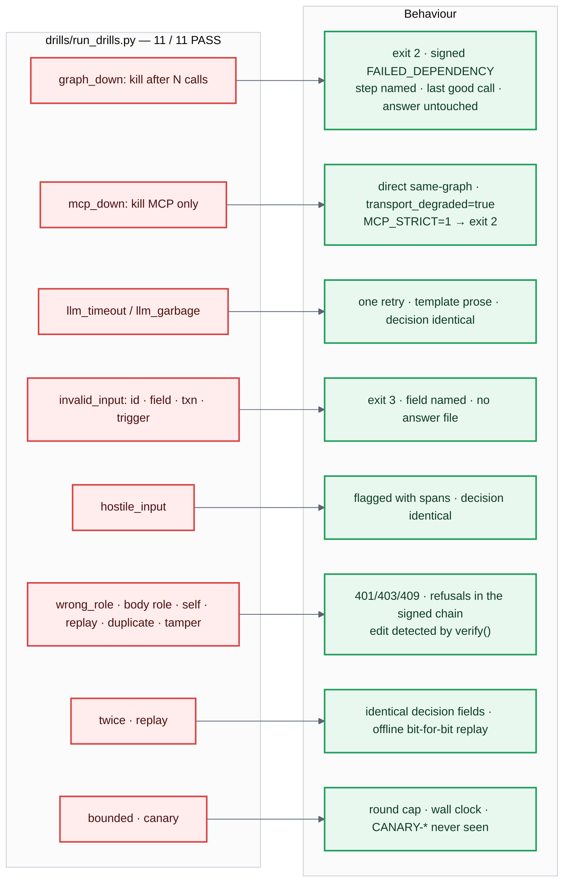

# 10 · Harness — failure behaviour and the drills

**What judges look for** in every drill: a clear error, no invented answer, no false "saved"
status, consistent results. Each row is a script in `drills/run_drills.py` (results in
`eval/reports/drills.md`), run against live TigerGraph on HHF-001.

**Proofs a judge can check in a minute**
- *Fail closed:* `DRILL_GRAPH_FAIL_AFTER=6 make case CASE=HHF-001` → exit 2, the answer file
  hash is unchanged, and a signed record names the step.
- *Not found ≠ invalid during an outage:* a missing transaction is only reported as invalid
  input after a healthy-graph precondition passes (this was a real bug, fixed).
- *Approvals:* the role comes from the bearer token's hash on the server; a body role is
  ignored and recorded as ignored; self-approval, wrong role, duplicate and replayed approvals
  are refused, and the refusals are themselves signed into the chain. Editing any record breaks
  `verify()`.
- *Same case twice:* identical decision-field hash; `make replay` reproduces it offline from the
  recording.
- *Temporal wall:* `make canary` plants `CANARY-*` transactions in 2099 on the case card; the
  negative control sees them, the investigation never does.
- *Model failures:* hard timeout, then one retry, then template prose (`prose_source:
  template`). Garbage that survives the id filter fails a quality floor and falls back too
  (a real bug caught by `llm_garbage`, fixed).

---
[← index](README.md)
