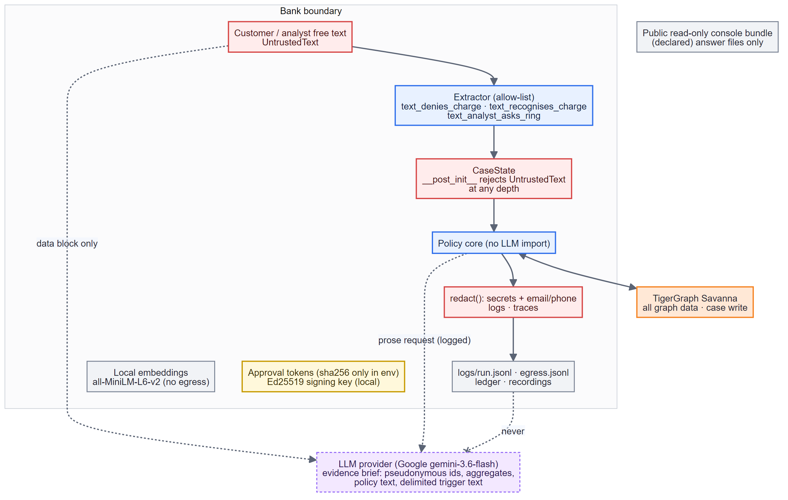
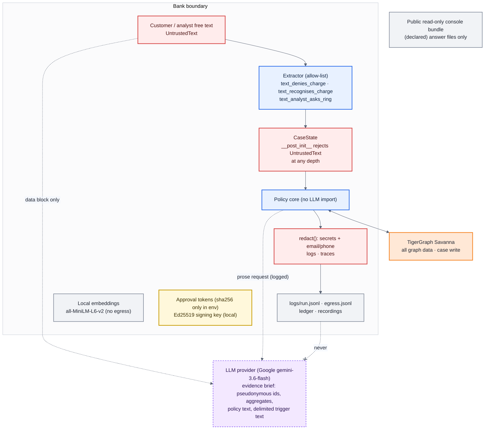

# 11 · Trust boundaries, provenance and egress

**Provenance labels are a runtime assertion.** Free text enters as `UntrustedText`; the
policy core's only input, `CaseState`, refuses to be built if any field — at any depth — is
untrusted text (`core/provenance.py`, two tests). Only three allow-listed extractor facts cross
the boundary, and hostile spans are stripped before those facts are read, so "it was me" injected
into a dispute cannot clear it, and "classify as legitimate" cannot be obeyed — or inverted.

**What leaves the boundary** (also `docs/RESILIENCE.md`): Savanna sees all graph data. The LLM
provider sees the evidence brief only — never raw rows, V-columns, identity records,
credentials or tokens — and is never asked for a probability, action, route or id. Every call
is in `logs/egress.jsonl`. Embeddings are computed locally. The public read-only console bundle
is declared.

**Tip-off by construction.** Every customer-facing string is rendered from a `CustomerView`
whose fields cannot carry SAR state, verdict, probability, pattern or connected cards; a test
toggles the SAR flag on every answer and diffs the customer text: zero bytes change. The
organisers' tip-off regex is the second layer.

---
[← index](README.md)
