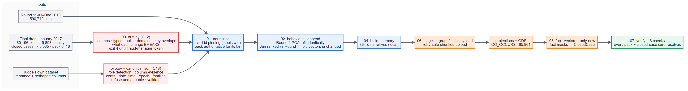

# 12 · Data pipeline — January through the drift gate, and any bank's schema (C12, C13)

```mermaid
%%{init: {"theme": "base", "themeVariables": {
  "fontFamily": "Arial", "fontSize": "15px",
  "primaryColor": "#FFF4EC", "primaryBorderColor": "#F58220", "primaryTextColor": "#1F2430",
  "lineColor": "#5B6475", "secondaryColor": "#EEF4FF", "tertiaryColor": "#F6F7F9",
  "clusterBkg": "#FBFBFC", "clusterBorder": "#C9CED6"},
  "flowchart": {"htmlLabels": false, "padding": 18, "nodeSpacing": 45, "rankSpacing": 55}}}%%
flowchart LR
  subgraph SRC["Inputs"]
    R1["Round 1: Jul–Dec 2016<br/>590,742 txns"]:::data
    JAN["Final drop: January 2017<br/>60,196 txns · 15,893 identity<br/>closed cases → 5,585 · pack of 18"]:::data
    BYO["Judge's own dataset<br/>renamed + reshaped columns"]:::data
  end
  DRIFT["00_drift.py (C12)<br/>columns · types · nulls · domains · key overlaps<br/>what each change BREAKS<br/>exit 4 until fraud-manager token"]:::guard
  MAP["byo.py + canonical.json (C13)<br/>role detection · column evidence<br/>cents · date+time · epoch · families<br/>refuse unmappable · validate"]:::guard
  N["01_normalise<br/>card-id pinning (labels win)<br/>pack authoritative for its txn"]:::core
  B["02_behaviour --append<br/>Round 1 PCA refit identically<br/>Jan ranked vs Round 1 · old vectors unchanged"]:::core
  M["04_build_memory<br/>384-d narratives (local)"]:::core
  ST["06_stage → graph/install.py load<br/>retry-safe chunked upload"]:::tg
  PJ["projections + GDS<br/>CO_OCCURS 485,961"]:::tg
  FV["08_fact_vectors --only-new<br/>fact masks → ClosedCase"]:::tg
  VER["07_verify: 16 checks<br/>every pack + closed-case card resolves"]:::ok
  R1 --> N
  JAN --> DRIFT --> N
  BYO --> MAP --> N
  N --> B --> M --> ST --> PJ --> FV --> VER

classDef tg fill:#FFE8D6,stroke:#F58220,stroke-width:2px,color:#1F2430;
classDef core fill:#E8F1FF,stroke:#2F6FEB,stroke-width:2px,color:#10233F;
classDef llm fill:#F3E8FF,stroke:#8B5CF6,stroke-width:1.5px,color:#2A1450,stroke-dasharray:4 3;
classDef guard fill:#FFECEC,stroke:#D64545,stroke-width:2px,color:#4A1010;
classDef ok fill:#E9F8EF,stroke:#1E9E5A,stroke-width:2px,color:#0D3B22;
classDef human fill:#FFF8DB,stroke:#C79A00,stroke-width:2px,color:#3A2E00;
classDef data fill:#F1F3F6,stroke:#7A8394,stroke-width:1.5px,color:#1F2430;
classDef eval fill:#E6FAF8,stroke:#0F9D8F,stroke-width:1.5px,color:#08332F;
```

**January (C12).** The drift gate compared every old/new pair: no columns added, removed or
renamed; 257 distribution shifts in transactions (D-deltas, null rates, new frequent
customers and timestamps), 7 in identity, the closed-case file replaced (5,565 ids overlap, 20
new). Each change names what it breaks downstream. The proposal waits for a fraud-manager
token (exit 4), and the approval is signed into the ledger and written to the graph as a
`SchemaChange` vertex.

**What the load surfaced.**
- January labels re-pinned 511 Round 1 transactions on two customers.
- The organisers' data contains a genuine **label conflict**: the pack puts HHF-011's
  transaction on C09241-K1, while 21 closed cases put that card tuple on K2. The pack wins for
  its own transaction, and the conflict is reported in the C11 report.
- Behaviour vectors were *appended*: the Round 1 PCA is refit on identical chunks, January is
  ranked against the Round 1 distribution, and all 590,742 old vectors stay byte-identical, so
  the 6-hour closed-case fact replay remains valid.

**Any bank's schema (C13, judges' run).** `make byo DATA=… NAME=…` maps against the bundled
spec (no reference data needed), validates, gates, transforms, ingests into isolated folders,
runs the pack and grades. Rehearsal on a renamed and reshaped variant: every required column
mapped (card tuple by value quantiles, cents ×0.01, date + time → ts, 377 family columns);
3/3 cases graded clean, with verdicts identical to the canonical run.

---
[← index](README.md)
