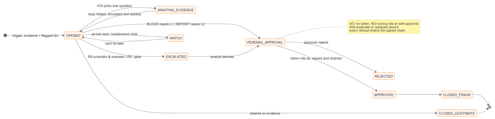
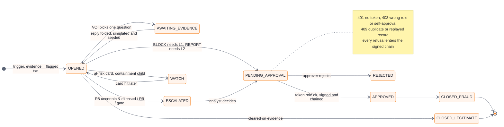

# 13 · Case lifecycle and governance (C14, C8, §2)

**A case is a record with a life.** Each run appends a version of its state changes to
`data/lifecycle/<case>.jsonl` and writes them to the graph as `CaseStateChange` vertices. Each
transition names the evidence that caused it, when it happened, and who acted. Each human
approval appends a transition with its ledger sequence and hash. Nothing is overwritten; a
rerun whose decision changed is flagged `changed_since_last_run`.

**Handover note** (console *Case life* tab): where the case stands, what it waits on and whose
approval, what the agent already did, the open questions, what changed after evidence, the
proof margin and the gate's reason. This is what lets an analyst take over cold.

**Approvals (§2, brief §9).** Bearer token → role on the server (SHA-256 hashes in the env);
L1 needs team lead or fraud manager, L2 needs fraud manager. The body role is ignored, and the
proposer cannot approve. Records are append-only, Ed25519-signed and hash-chained, and bind
case id, action index and answer hash, so a replay against another case or a changed decision
fails.

**Analyst in the loop (C8).** Accept/reject on findings through the same ledger discipline.
One feedback round on the October holdout cut legitimate customers acted against from 46 to 42,
with every adjustment naming the feedback ids that caused it.

---
[← index](README.md)
