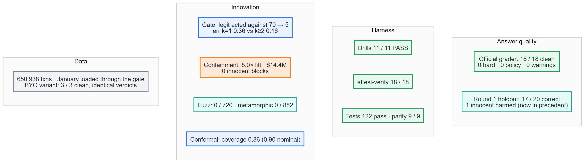
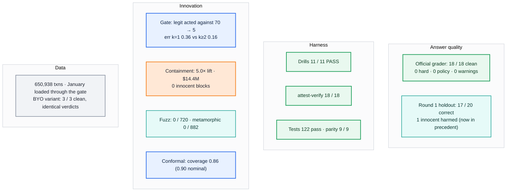

# 16 · Results at a glance (final run)

Every number is generated by a script and stored in `eval/reports/`. The figures below are
regenerated into the README by `scripts/readme_numbers.py`.

| Area | Number | Source |
|---|---|---|
| Official grader on the 18 | 18/18 clean, 0 hard, 0 policy, 0 warnings | `eval/reports/grade_official.md` |
| Final verdicts | 10 legitimate · 7 fraud · 1 uncertain; 3 SARs; gate changed 1 (HHF-016) | `run_summary.md` |
| Hostile text | 6/6 flagged; 0/720 fuzzed runs changed a decision | `metamorphic.md` |
| Data quality | 5/18 tainted; 1 organiser label conflict | `data_quality.md` |
| Proof gate (Oct holdout) | legit acted against 70 → 5; harmful error 0.36 (k=1) vs 0.16 (k≥2) | `proof_holdout.md` |
| Containment backtest | agent arm 0.37 precision, 5.0× lift, $14.4M pre-empted, 0 innocent blocks | `containment_backtest.md` |
| Conformal | Oct coverage 0.86 (fraud 0.81, legit 0.94) | `conformal.md` |
| Drills | 11/11 pass | `drills.md` |
| Attestations | 18/18 re-run and match on live TigerGraph | `attest_verify.md` |
| Round 1 honesty | 17/20 correct; HHG-004 (legit) was blocked | `hhg_holdout.md` |
| Latency / cost | p95 ≈ 284 s with LLM prose; ≈ $0.001 per case (prose cached) | `run_summary.md` |

---
[← index](README.md)
